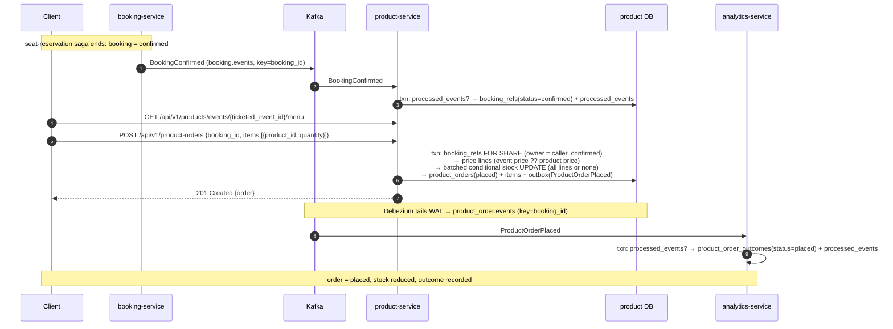

# Saga: product-order

> Status: **design only** — no Kafka code wired yet. This file is the contract that
> `saga-consistency-reviewer` checks the implementation against. Wire it in the
> reviewable steps listed in [§11](#11-implementation-order).

## 1. Summary

After a booking's seats are confirmed (the [seat-reservation](seat-reservation.md) saga ends in
`BookingConfirmed`), the customer adds food and drinks to that booking by calling
`POST /api/v1/product-orders` on **product-service** (NestJS, port 8086, JWT required, 300 req/min).

This saga is deliberately different in shape from seat-reservation: the order is decided by **one
local transaction** in product-service (verify the booking, take the stock, write the order, write the
event), so there is no cross-service "pending" state and nothing to time out. The cross-service parts
are (a) a **read-model projection** — product-service learns which bookings are confirmed from
`BookingConfirmed` / `BookingCancelled`, with no synchronous call to booking-service, and (b) a
**compensation** — if a booking is later cancelled, or the customer cancels the order, the stock is put
back and the order is cancelled. **analytics-service** consumes the order events into a read model.

End states of an order: `placed` (stock held for the customer) or `cancelled` (stock restored). An order
that cannot be placed (no confirmed booking, stock, availability) is rejected synchronously and leaves
no trace in any service.

booking-service is **unchanged**. Today it refuses `confirmed → cancelled` (`AlreadyTerminal`), so
`BookingCancelled` never follows `BookingConfirmed`; the compensation triggered by it is therefore
dormant until booking-service gains a post-confirmation cancel. The **customer cancel** endpoint
(`DELETE /api/v1/product-orders/{id}`) exercises the same cancellation path today.

Every event in this saga is partitioned by `booking_id`, so a Kafka partition preserves per-booking
ordering across a booking's orders (a booking can have several orders over time: place → cancel →
place again).

## 2. Participants and ordered steps

| # | Service | Role | Local transaction (one DB txn) | Emits |
|---|---|---|---|---|
| 0 | **booking-service** | existing, unchanged | (seat-reservation saga) | `BookingConfirmed`, `BookingCancelled` |
| 1 | **product-service** | reactor (`consume:BookingConfirmed`) — projection | `processed_events` check → `INSERT INTO booking_refs (booking_id, user_id, ticketed_event_id, status='confirmed') ON CONFLICT (booking_id) DO NOTHING` | — |
| 2 | **product-service** | **initiator** (`http:POST /api/v1/product-orders`) | `SELECT … booking_refs … FOR SHARE` → price lines from `event_inventory` ⨝ `products` → one batched conditional `UPDATE event_inventory` (stock) → `INSERT product_orders` + `product_order_items` + write/delete `outbox_events` | `ProductOrderPlaced` |
| 3 | **product-service** | **initiator** (`http:DELETE /api/v1/product-orders/{id}`) — customer cancel | `SELECT … product_orders … WHERE id AND user_id FOR UPDATE` → if `placed`: `status='cancelled'`, restock items, write/delete `outbox_events`; if already `cancelled`: no-op | `ProductOrderCancelled` (only when it actually cancelled) |
| 4 | **product-service** | reactor (`consume:BookingCancelled`) — **compensation** | `processed_events` check → `INSERT INTO booking_refs (…, status='cancelled') ON CONFLICT (booking_id) DO UPDATE SET status='cancelled'` → for each `placed` order of the booking (`FOR UPDATE`): same cancellation as step 3 with reason `booking_cancelled` | `ProductOrderCancelled` per order that was cancelled |
| 5a | **analytics-service** | reactor (`consume:ProductOrderPlaced`) — read model | `processed_events` check → upsert `product_order_outcomes` (status `placed`, never overwriting `cancelled`) | — (terminal) |
| 5b | **analytics-service** | reactor (`consume:ProductOrderCancelled`) — read model | `processed_events` check → upsert `product_order_outcomes` (status `cancelled`, cancellation details) | — (terminal) |

Step 1 and step 2 are connected only through data (`booking_refs`), not through a call: the client is
told the booking is `confirmed` by booking-service first, then orders. Steps 5a/5b run independently.

## 3. Event catalog

Topic is always `<aggregate_type>.events`; its DLQ is `<aggregate_type>.events.dlq`. Partition key is
always the `aggregate_id`, which here is the `booking_id` for every event. Payload keys are snake_case
and become the Kafka message value verbatim; `event_id` is the event's own UUID (= the
`outbox_events.id` column) and is the idempotency key. `ticketed_event_id` is the `events.id` of the
event being booked (never a bare `event_id`, which would collide with the saga event id).

| Event | `aggregate_type` | Topic | Partition key | Producer | Consumer group(s) | Delivery guarantee | Payload fields |
|---|---|---|---|---|---|---|---|
| `BookingConfirmed` *(existing)* | `booking` | `booking.events` | `booking_id` | booking-service | `product-service-booking-events` | **effectively-once** — a duplicate must not re-create or flip a projection row; dedupe on `event_id`. | `event_id` uuid, `booking_id` uuid, `user_id` uuid, `ticketed_event_id` uuid, `seat_ids` uuid[], `occurred_at` string(RFC3339) |
| `BookingCancelled` *(existing)* | `booking` | `booking.events` | `booking_id` | booking-service | `product-service-booking-events` | **effectively-once** — drives a restock; a duplicate would restock twice. Dedupe on `event_id`. | as `BookingConfirmed` plus `reason` string |
| `ProductOrderPlaced` | `product_order` | `product_order.events` | `booking_id` | product-service (outbox/CDC) | `analytics-service-ProductOrderPlaced` | **effectively-once** — consumer upserts by `order_id` and dedupes on `event_id`. | `event_id` uuid, `order_id` uuid, `booking_id` uuid, `user_id` uuid, `ticketed_event_id` uuid, `currency` string, `total_minor` int, `item_count` int (units), `items` [{`product_id` uuid, `name` string, `quantity` int, `unit_price_minor` int, `line_total_minor` int}], `placed_at` string(RFC3339) |
| `ProductOrderCancelled` | `product_order` | `product_order.events` | `booking_id` | product-service (outbox/CDC) | `analytics-service-ProductOrderCancelled` | **effectively-once** — same as above. | `event_id` uuid, `order_id` uuid, `booking_id` uuid, `user_id` uuid, `ticketed_event_id` uuid, `currency` string, `total_minor` int, `item_count` int, `reason` string (`customer_cancelled` \| `booking_cancelled`), `cancelled_at` string(RFC3339) |

No event in this saga is at-most-once: every one carries state and travels through the transactional
outbox. Money is always integer minor units.

**One topic, several event types.** `booking.events` carries `BookingRequested`, `BookingConfirmed` and
`BookingCancelled`; product-service **acks-and-skips** `BookingRequested`. `product_order.events`
carries two types; each analytics group acks-and-skips the other (guard on the `event_type` header).

**Why product-service uses one consumer group and analytics uses two.** product-service's two reactions
are applied through a *monotonic* projection (`cancelled` always wins over `confirmed`, see §5.8), so
order does not matter for correctness, but running both on one group keeps the Nest transport simple
(each Nest Kafka connection is one group that subscribes every registered handler; two groups on one
topic would double-process every message). analytics-service follows the repo precedent of one group
per event type, which works because its projection is commutative (§5.9).

## 4. Happy path

Terminal: `product_orders.status='placed'`, `event_inventory.stock_available` reduced by the ordered
quantities, one `product_order_outcomes` row with `status='placed'`.

## 5. Failure sequences

### 5.1 Booking not confirmed (or the projection has not caught up)

`POST /product-orders` finds no `booking_refs` row for `booking_id`. The request is rejected `409
booking not confirmed` with nothing written. This covers both a genuinely unconfirmed booking and the
sub-second window between booking-service confirming and product-service consuming `BookingConfirmed`;
the client retries. No event, no compensation. If the `BookingConfirmed` message is dead-lettered
(§8), the row never appears and ordering stays blocked until an operator replays the DLQ — surfaced by
the existing `dlq-depth` alert.

### 5.2 Someone else's booking

A `booking_refs` row exists but `user_id` differs from the JWT `sub`: `404 booking not found` (the same
owner-scoped behaviour as booking-service; the booking id is a UUID, so this is not an enumeration
oracle in practice). Nothing written.

### 5.3 Booking already cancelled

`booking_refs.status='cancelled'`: `409 booking cancelled`. Nothing written.

### 5.4 Product not available or insufficient stock

A requested line has no *active* `event_inventory` row for this `ticketed_event_id` (or its product is
inactive): `409 product not available`. The batched conditional stock `UPDATE` updates fewer rows than
there are lines (`stock_available < quantity`): `409 insufficient stock`. In both cases the transaction
rolls back **before** any order row or outbox row exists, so stock is untouched and nothing is
published. All lines or none — never a partial order.

### 5.5 Invalid request

More than the configured number of lines, a quantity outside the configured range, a duplicate
`product_id`, lines in different currencies, or a total that overflows the safe-integer range: `400`.
Nothing written.

### 5.6 An order already exists for the booking

A unique partial index allows one `placed` order per `booking_id`. A second `POST` (including a client
retry after a lost response) fails with `23505` on that index and is mapped to `409 order already
exists for booking`. Cancel it first (step 3) to place a new one. This index is the idempotency
mechanism for placement; there is no `Idempotency-Key` header.

### 5.7 Concurrency

- **Oversell.** Stock is only ever changed by one batched conditional `UPDATE … SET stock_available =
  stock_available - qty … WHERE stock_available >= qty` (never read-modify-write), with `CHECK
  (stock_available >= 0)` as a backstop. Lines are processed in `product_id` order so two orders touching
  the same products take row locks in the same order and cannot deadlock.
- **Order vs `BookingCancelled`.** Placement reads the booking row with `FOR SHARE`; the cancel
  reaction writes it (`UPDATE`/upsert to `cancelled`), which needs an exclusive lock. If the order
  commits first, the cancel reaction then sees the new `placed` order and cancels it. If the cancel
  reaction commits first, the placement's `FOR SHARE` waits, re-reads `cancelled`, and rejects with
  5.3. No interleaving leaves a `placed` order on a cancelled booking.
- **Customer cancel vs `BookingCancelled`.** Both lock the order row `FOR UPDATE`. Whichever runs
  second finds it already `cancelled` and is a no-op, so exactly one `ProductOrderCancelled` is
  emitted per order.

### 5.8 Compensation: the booking is cancelled after orders were placed (dormant today)

`BookingCancelled` → step 4: the `booking_refs` upsert flips the row to `cancelled` (creating it if the
booking was never confirmed here — harmless), then every `placed` order of that booking is cancelled in
the **same transaction**: status `cancelled`, items' quantities added back to `stock_available`, and one
`ProductOrderCancelled` (reason `booking_cancelled`) per order written to the outbox. The projection is
monotonic: `BookingConfirmed` uses `ON CONFLICT DO NOTHING`, so a late or replayed `BookingConfirmed`
can never resurrect a cancelled booking. Terminal state: order `cancelled`, stock restored.

Can the compensation itself fail? Only transiently (DB blip, deadlock): the consumer retries with
backoff and then dead-letters; permanent errors dead-letter immediately. A restock is never applied
twice because the whole reaction sits behind the `processed_events` check in the same transaction.

### 5.9 analytics read model

The projection is **commutative** so the two analytics groups may run in either order:
`ProductOrderPlaced` is `INSERT … ON CONFLICT (order_id) DO UPDATE SET item_count, placed_at` (status is
left alone); `ProductOrderCancelled` is `INSERT … ON CONFLICT (order_id) DO UPDATE SET status='cancelled',
cancelled_at, cancel_reason`. Both payloads carry the full order identity (`booking_id`, `user_id`,
`ticketed_event_id`, `currency`, `total_minor`, `item_count`), so a row created by either event is
complete. analytics has no downstream step, so there is nothing to compensate; a poison event is
dead-lettered and the read model is simply missing that row until replay.

### 5.10 Poison, permanent and exhausted messages

Any consumer in this saga: an undeserializable or schema-invalid payload (including an empty value) →
`<topic>.dlq` with diagnostic headers, then commit; a permanent domain rejection (`23xxx`/`22xxx`/`42xxx`
SQLSTATE) → DLQ immediately; a transient error → retry in place with capped backoff up to
`KAFKA_CONSUMER_MAX_ATTEMPTS`, then DLQ. A failed DLQ write retries **the same message in place** and is
never committed past.

## 6. Compensation map

| Forward step | Committed change | Failure trigger | Compensating step | Owning service | Terminal state |
|---|---|---|---|---|---|
| `BookingConfirmed` projection (1) | `booking_refs` row `confirmed` | `BookingCancelled` | upsert row to `cancelled` (4) | product-service | `cancelled` |
| `PlaceProductOrder` (2) | order `placed`, stock decremented, `ProductOrderPlaced` | customer cancel, or `BookingCancelled` | `CancelProductOrder` (3 / 4): order `cancelled`, stock restored, `ProductOrderCancelled` | product-service | `cancelled` |
| analytics projections (5a/5b) | read-model rows | — | none: read-only terminal step, rebuilt by DLQ replay | analytics-service | — |

A rejected placement (5.1–5.6) needs no compensation: it rolls back before anything is committed.

## 7. Stuck-saga policy

There is **no non-terminal state** to get stuck in. An order is `placed` or `cancelled`; it is never
`pending`, so there is no reaper and no timeout. The only waits are:

- The client waiting for the projection (5.1): bounded by Debezium plus consumer latency (sub-second in
  the dev stack); the client retries a `409 booking not confirmed`.
- A projection missing because `BookingConfirmed` was dead-lettered: a visible, alertable condition
  (`dlq-depth`), resolved by replaying the DLQ record. There is no auto-heal.

What a client polling sees: `GET /api/v1/product-orders/{id}` returns the order with `status`
(`placed` / `cancelled`); the `POST` itself answers synchronously with `201` or a `4xx`.

Out of scope here (no state to reconcile yet): payment, fulfilment/pickup, a cutoff when the event
starts (product-service does not know event times), and editing an order in place (cancel and re-place).

## 8. Idempotency and DLQ requirements per consumer

| Consumer | Group id | Idempotency | DLQ |
|---|---|---|---|
| product-service `RecordBookingConfirmed` + `HandleBookingCancelled` | `product-service-booking-events` (one group; Nest `postfixId: ''` so the id is not suffixed `-server`) | `processed_events` check → side effect, same txn; `BookingRequested` acks-and-skips | `booking.events.dlq` |
| analytics-service `RecordProductOrderPlaced` | `analytics-service-ProductOrderPlaced` | `processed_events` check + upsert by `order_id`, same txn | `product_order.events.dlq` |
| analytics-service `RecordProductOrderCancelled` | `analytics-service-ProductOrderCancelled` | same | `product_order.events.dlq` |

Classification (all consumers, per CLAUDE.md): success or idempotent no-op → commit; transient SQLSTATE
(`40001`, `40P01`, `55P03`, `55006`, `53300`, `08xxx`, `57P01/02/03`) or no database code at all →
retry with 250 ms doubling backoff capped at 30 s, up to `KAFKA_CONSUMER_MAX_ATTEMPTS` (default 5), then
DLQ with reason `max-retries after N attempts: …`; constraint/data/schema errors, undeserializable
payloads and permanent domain rejections → DLQ at once. DLQ records keep the original key and value plus
`x-dlq-reason`, `x-dlq-source-topic`, `x-dlq-source-partition`, `x-dlq-source-offset`. Consumers start
from `earliest` with auto-commit off and commit `offset + 1` only after the message is fully resolved.

## 9. Infra delta

- **Topics** (`kafka-init` in `docker-compose.yml`): `product_order.events` (3 partitions) and
  `product_order.events.dlq` (1 partition); env `KAFKA_PRODUCT_ORDER_EVENTS_TOPIC`.
- **Debezium**: product-service publishes for the first time, so a new
  `debezium/product-service-outbox.json` (copy of `event-service-outbox.json`: `postgres-product`,
  `slot.name=product_service_outbox`, `publication.name=dbz_product_outbox`, `topic.prefix=productdb`,
  `table.include.list=public.outbox_events`, same `EventRouter` mapping). Register it in `connect-init`,
  add `postgres-product` to `kafka-connect`'s `depends_on`, and add its status URL to the blackbox
  connector probes in `monitoring/prometheus/prometheus.yml`. `postgres-product` already runs with
  `wal_level=logical`.
- **product-service compose env/deps**: `KAFKA_BROKERS`, `KAFKA_BOOKING_EVENTS_TOPIC`,
  `KAFKA_PRODUCT_ORDER_EVENTS_TOPIC`, `KAFKA_CONSUMER_MAX_ATTEMPTS`; `depends_on` kafka, `kafka-init`,
  `connect-init`.
- **Kong**: a `product-order-routes` route on `/api/v1/product-orders` — `GET`, `POST`, `DELETE`,
  `OPTIONS`, JWT (`exp` verified), 300 req/min. `DELETE` is already allowed by the global CORS config.
- **Migrations — product-service** (TypeORM migration classes, additive, one deploy):
  `outbox_events` (canonical shape, no `published_at`), `processed_events` (unique `event_id`),
  `booking_refs` (`booking_id` PK, `user_id`, `ticketed_event_id`, `status` TEXT+CHECK, `updated_at`),
  `product_orders` (UUID PK, `booking_id`, `user_id`, `ticketed_event_id`, `currency`, `total_minor`,
  `status` TEXT+CHECK, `cancel_reason`, timestamps; **unique partial index on `booking_id` where
  `status='placed'`**; index on `(user_id, created_at DESC, id)` for the list endpoint),
  `product_order_items` (`order_id` FK + `product_id` PK, `name`, `quantity` CHECK > 0, `unit_price_minor`,
  `line_total_minor`; the PK prefix indexes the FK).
- **Migrations — analytics-service**: `product_order_outcomes` (`order_id` PK, `booking_id`, `user_id`,
  `ticketed_event_id`, `currency`, `total_minor`, `item_count`, `status` TEXT+CHECK, `placed_at`,
  `cancelled_at`, `cancel_reason`); index on `ticketed_event_id`. `processed_events` already exists there.
- **API surface** (product-service): `POST /api/v1/product-orders` (`201` / `400` / `401` / `404` / `409`),
  `GET /api/v1/product-orders` and `GET /api/v1/product-orders/{id}` (owner-scoped, paginated, foreign
  order ⇒ `404`), `DELETE /api/v1/product-orders/{id}` (`200` with the order; idempotent; `404` if not
  the caller's).

## 10. Choreography sanity check

Hop count: at most **1** event hop between services on any path (booking-service → product-service for
the projection; product-service → analytics-service for the read model). The order itself is driven by the
client request, not by a chain of events, so there is no multi-hop pipeline to follow. Conditional
branches: 1 (cancel reaction: order `placed` or already `cancelled`). Well within the ≤ 4 hops / ≤ 2
branches budget; no orchestrator needed.

## 11. Implementation order

Each step is a separate, reviewable PR; this document is the first.

1. **This design** (docs only).
2. product-service persistence: the five product-service migrations, `ProductOrder` domain (pricing and
   total arithmetic), repositories incl. the batched stock statement and `writeOutbox`, and the
   `PlaceProductOrder` / `CancelProductOrder` / `Get` / `List` use cases.
3. product-service Kafka adapter: hybrid Nest app, the consumer with manual commit, retry and DLQ, the
   SQLSTATE classifier, and the `RecordBookingConfirmed` / `HandleBookingCancelled` use cases.
4. product-service orders API: controller, DTOs, mappers, and wiring.
5. analytics-service: `RecordProductOrderPlaced` / `RecordProductOrderCancelled`, the migration, and the
   two consumer specs.
6. Tests: `ProductOrder` pricing unit specs, a Kafka integration test (Testcontainers) covering commit
   ordering, skip, poison, permanent, transient, exhausted and DLQ-unavailable, and component tests for the
   orders API and the booking-cancelled compensation.
7. Infra: topics, Debezium connector, compose, Kong route, Prometheus, API docs.
